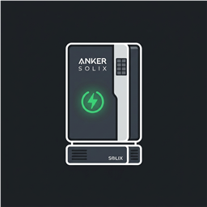
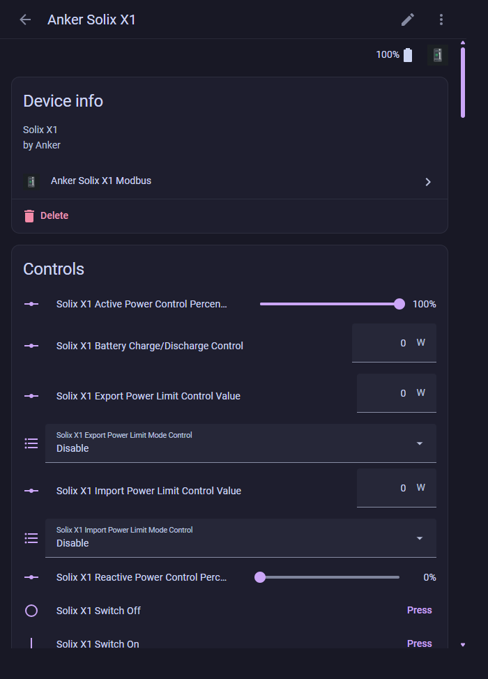
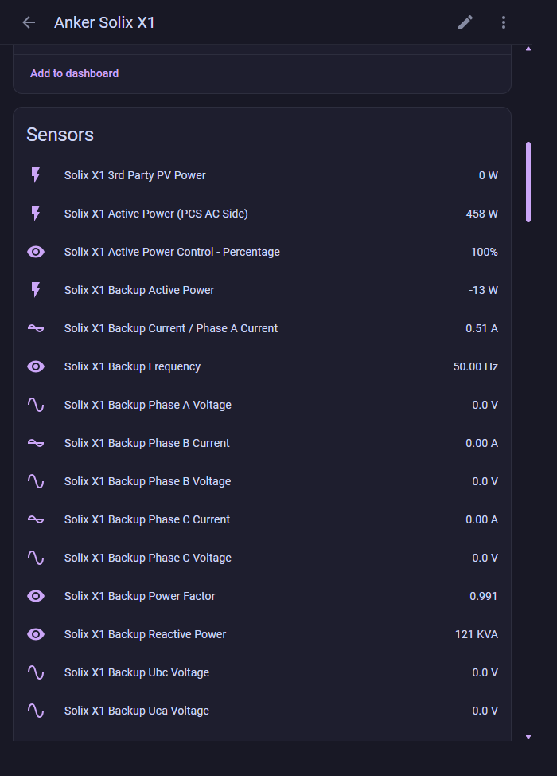

  

# Anker Solix X1 Modbus Integration

A custom Home Assistant integration to communicate with Anker Solix X1 energy storage systems via Modbus TCP.

This integration was built to replace manual `modbus.yaml` configurations, allowing you to easily set up your inverter from the Home Assistant UI while automatically retaining all your historical Energy Dashboard data!

## Screenshots

| Controls | Sensors |
|---|---|
|  |  |

## Requirements
- Home Assistant 2024.12.0 or newer.
- An Anker Solix X1 with Modbus TCP enabled and reachable from Home Assistant (default port `502`).
- Only one Modbus TCP client can normally talk to the inverter at a time.

## Features
- **100% UI Configurable:** No more editing massive YAML files.
- **Data Continuity:** Designed to use the exact same Entity IDs as standard community YAML configurations. Your historical energy statistics will transition seamlessly.
- **Comprehensive:** Maps 142 sensors, including PV generation, grid power, battery status, and internal temperatures.

## Supported Entities
This integration exposes all critical metrics across various categories, including but not limited to:
- **Summary Information:** Plant Status, Battery Status, SOC, SOH
- **Power Flow:** PV Power, Grid Power, Load Power, Battery Charge/Discharge Power
- **Energy Counters:** Daily/Total PV Generation, Battery Charge, Feed-in, Purchased Energy
- **PCS Status & Alarms:** Rated Power, MPPT strings, System Alarms (1-8), Internal Temperature
- **Voltage & Current:** PV1-PV4 Voltage and Current, Grid Voltage
- **Controls (write access):** Switch On/Off buttons, Work Mode and import/export limit mode selects, and power-control numbers. These write to the inverter's holding registers. A rejected or failed write is reported as an error in Home Assistant. Use them with care; automations should not drive them unless you intend to control the inverter.

## Installation

### Method 1: HACS (Recommended)

1. Open Home Assistant and navigate to **HACS**.
2. Search for **Anker Solix X1 Modbus** (until it is in the default HACS list, add `https://github.com/cbource/anker-solix-x1-modbus` as a custom repository of type **Integration**).
3. Click **Download**.
4. Restart Home Assistant.
5. Go to **Settings > Devices & services > Add integration** and search for **Anker Solix X1 Modbus**.

### Method 2: Manual
1. Download the latest release from this repository.
2. Copy the `custom_components/anker_solix_x1` folder into your Home Assistant `config/custom_components` directory.
3. Restart Home Assistant.

## Configuration

### New Setup
1. Go to **Settings > Devices & Services > Integrations**.
2. Click **Add Integration** and search for "Anker Solix X1".
3. Enter your Inverter's IP Address (e.g., `192.168.0.139`), Port (default `502`), and **Scan Interval**.
   - **Scan Interval (Polling Frequency):** Defines how often the integration queries the inverter for updates. The unit is in **seconds**. 
   - **Recommendation:** A value of `30` seconds is recommended. Setting this too low (e.g., `< 10`) may overwhelm the inverter's Modbus TCP interface and cause connection timeouts, while setting it too high will result in sluggish dashboard updates.
4. Click Submit. All sensors, controls and buttons will be automatically created!

### Migrating from YAML
If you are currently using a `modbus.yaml` configuration for your Anker Solix X1, follow these steps to migrate without losing your Energy Dashboard history:

1. **Comment out your existing modbus configuration.** In your `configuration.yaml`, comment out or remove the `modbus: !include modbus.yaml` line.
2. **Restart Home Assistant.** Your old entities will show as "Unavailable" — this is expected.
3. **Install the HACS integration** using the steps in the Installation section above, then restart again.
4. **Add the integration via the UI** (Settings > Devices & Services > Add Integration > "Anker Solix X1").
5. **Verify your Energy Dashboard.** If your previous YAML used the standard community `unique_id` values (e.g., `solix_x1_pv_power`, `solix_x1_daily_pv_generation`), the new integration will create entities with the exact same IDs. Your Energy Dashboard and long-term statistics will continue seamlessly — no data loss.

> **Note:** If your previous YAML used *custom* `unique_id` values that differ from the standard ones listed above, the new entity IDs won't match automatically. In that case, go to each entity in the UI (Settings > Devices & Services > Entities), click the gear icon, and manually rename the Entity ID to match your old one.

## Potential Issues & Troubleshooting
- **Connection Refused / Timeout**: Modbus TCP typically only allows one connection at a time. Make sure you don't have another tool, Node-RED flow, or a residual `modbus.yaml` configuration trying to poll the inverter at the same time.
- **Unavailable Entities**: If your entities show up as unavailable, verify the inverter is online and connected to the same local network as your Home Assistant instance. Check the Home Assistant logs for specific Modbus exceptions.
- **Energy Dashboard Not Updating**: If you transitioned from YAML and the dashboard stopped updating, verify that the new Entity IDs exactly match the old ones (e.g., `sensor.solix_x1_daily_pv_generation`). See the migration section above.
- **Duplicate Integration Error**: The integration prevents adding the same inverter IP twice. If you see an "already configured" error, check your existing integrations.

## Disclaimer
This integration is community-supported and not officially affiliated with Anker. Use at your own risk.
